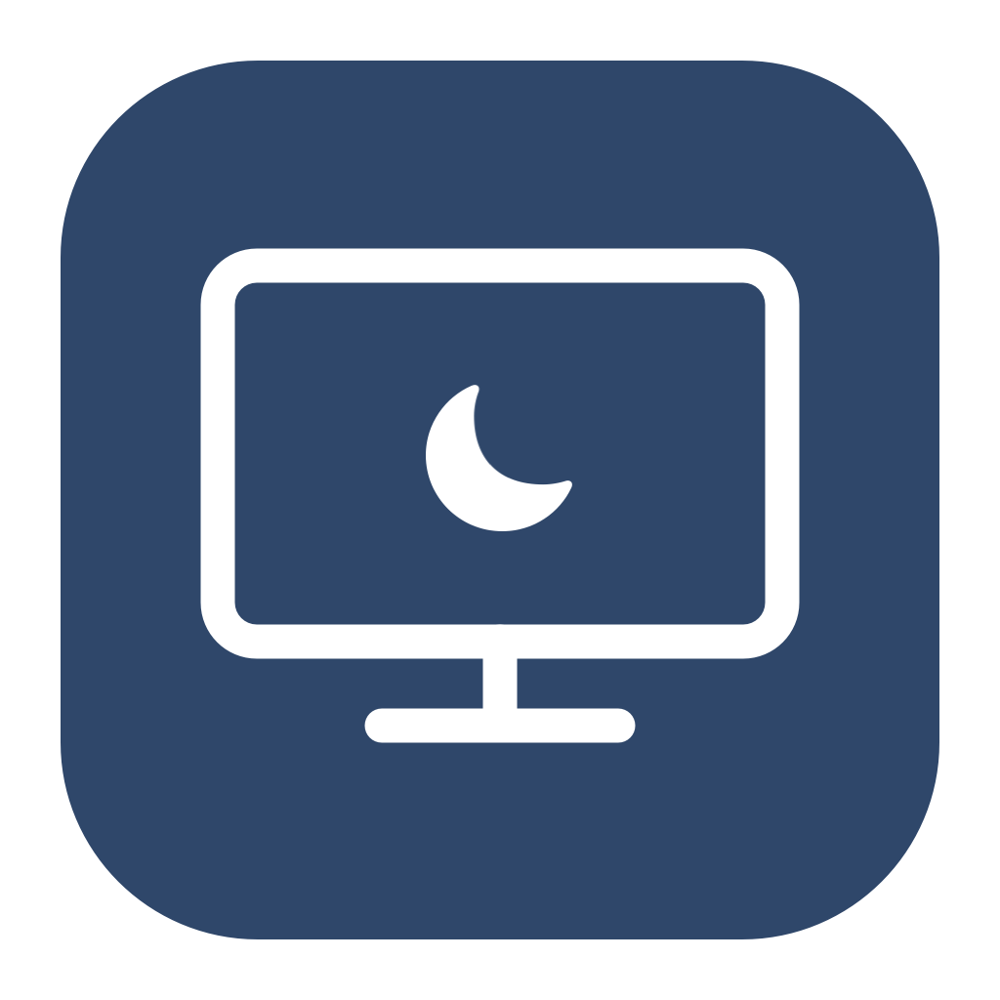

# 轻醒 · LightWake

屏幕休息，任务继续。

LightWake 是一款原生 macOS 屏幕工具：关闭显示器时防止电脑因闲置而睡眠，意外唤醒后自动倒计时熄屏，再双击一次即可恢复正常使用。



只有一个应用（`轻醒.app`），常驻菜单栏。关屏和开屏是同一个动作的两端，所以桌面按钮也只有
一个：**双击切换**。

## 功能

| 操作 | 怎么做 |
| --- | --- |
| 关闭屏幕 | 双击桌面上的「轻醒」，或菜单栏图标 →「关闭屏幕」。提示 3 秒，平移缩小到桌面左上角，再倒数 2 秒关闭显示器。 |
| 临时唤醒 | 自动熄屏模式中，屏幕实际唤醒后提示 3 秒，剩余 17 秒在左上角显示数字；到时再次关闭显示器。 |
| 锁屏后解锁 | 锁屏期间由 macOS 管理显示器，轻醒不因倒计时到期而关屏；成功解锁后再开始完整的 20 秒。 |
| 开启屏幕 | 再双击一次「轻醒」，或菜单栏图标 →「开启屏幕（退出熄屏模式）」：取消自动熄屏和当前倒计时，恢复正常使用。 |
| 按键规则 | 键盘、鼠标或外部映射按键触发指定目标，供键盘、鼠标和外部映射工具调用。 |
| 轻醒设置 | 菜单栏图标 →「轻醒设置…」。配置“哪个按键 → 哪个应用 / 项目文件夹”，查看关屏与亮屏说明。 |

菜单栏图标会跟着状态变：熄屏模式进行中是带感叹号的显示器，平时是普通显示器。

重复的唤醒通知不会延长 20 秒时限。倒计时结束前不会再次弹出大提示；多显示器会各自显示提示与左上角数字。


## 构建

需要 Apple silicon Mac、macOS 26 或更新版本、完整 Xcode 26 和 Python 3.10 或更新版本。首次使用 Xcode 时，请先完成其初始化，并确认命令行工具选中了完整 Xcode。

在仓库根目录执行：

```sh
python3 scripts/build.py
```

若报 `You have not agreed to the Xcode license agreements`：Xcode 跨大版本升级会让许可证同意失效
（同意记录存在 `/Library/Preferences/com.apple.dt.Xcode.plist` 里，版本对不上当前 Xcode 就不认），
之后 `swiftc`、`xcrun`、`lipo` 这几个命令行 shim 一律报这个错。在终端里跑一次即可：

```sh
sudo xcodebuild -license accept
```

构建产物使用本机临时签名，路径如下：

```text
apps/screen-guard/build/轻醒.app
```

## 安装与使用

```sh
python3 scripts/install.py
```

这条命令做两件事：把 `轻醒.app` 装进“应用程序”（替换前会把旧版挪到
`~/Documents/ProjectArchive/service-backups/<日期>-轻醒装机/`，不删），
然后在桌面放好一个替身：

| 桌面按钮 | 双击后 |
| --- | --- |
| 轻醒 | 切换熄屏模式：关屏 ↔ 正常使用。菜单栏的显示器图标里还有设置和退出 |

按钮用真正的 Finder 替身，不是符号链接。已在位的按钮不会重建（免得打乱 Finder 记住的
图标位置），只刷新注释；想强制重建加 `--force-shortcuts`。应用已经在位、只想重放按钮时
用 `--shortcuts-only`。更新时先退出正在运行的轻醒（菜单栏 →「退出轻醒」）。

3.0 之前是四个 app 和四个桌面按钮。装机时它们会被一并挪进归档 —— 「关闭屏幕 / 开启屏幕 /
轻醒按键」本来就是同一个反转的两端，留着只会让人点错。替换和退回都是整批的：装失败
（拷贝出错、签名自检不过）就把这一轮换掉的退回原状，不留半装状态。

自动熄屏模式运行期间，菜单栏中的显示器图标也提供“开启屏幕（退出模式）”和“立即关闭屏幕”。退出模式会释放防止闲置睡眠的声明，电脑随后遵循原有电源设置。

### “合盖不休”是什么意思

关屏模式持有 `PreventUserIdleSystemSleep` 电源声明，而它**只在两种情况下释放**：
用户手动退出模式（再双击一次「轻醒」、菜单栏退出、或按键规则取消），或应用退出。
**合盖不在其中** —— 合盖不会让它放手。

结果是机器合盖后停在浅睡状态（DarkWake）里反复醒来，后台任务继续跑。这正是这个模式
想要的“任务继续”，所以是有意保留的行为，不是遗漏；桌面按钮的 Finder 注释里写了这一条，
免得合盖之后以为已经收工了。

要注意边界：合盖睡眠本身由系统决定（`AppleClamshellCausesSleep`），
`PreventUserIdleSystemSleep` 拦不住合盖、手动选择睡眠和电量耗尽。
轻醒不改变系统的合盖策略，也不承诺所有机型上都得到同样结果。
要真正让机器休息，先双击「轻醒」退出模式，再合盖。

关闭显示器与锁屏是不同的系统行为。LightWake 保留系统的密码和锁屏设置：普通后台任务可继续运行，需要操作桌面窗口的任务可能仍需解锁，也不会自动恢复已经完成或等待用户输入的任务。

## 按键规则：哪个按键，打开哪个目标

在“轻醒设置 → 按键规则”中，新建一条规则：

1. 选择键盘快捷键、鼠标按键或外部映射按键。键盘和鼠标可以直接录制具体按键；手柄等映射工具使用该规则的独立调用命令。
2. 选择“亮屏并打开目标”或“切换屏幕；恢复亮屏时打开目标”。可限制为只在熄屏、锁屏或自动熄屏模式中执行。
3. 选择目标应用，也可指定项目文件夹。不同按键可以打开不同目标。
4. 勾选“启用这条规则”并保存。键盘和鼠标规则需要通过“授权输入监控”按钮手动授权；原按键仍会传给其他应用。

新建规则默认停用。普通屏幕唤醒不执行任何目标；只有匹配该规则的按键或映射入口才执行。亮屏后若需要密码，会等你正常解锁、桌面稳定后再打开这次按键指定的应用和项目。关闭或删除规则后停止执行，无需修改源码或重新构建。

Joy-Con 的具体按键和 Karabiner 映射由独立的手柄项目维护。3.0 之前那条打开“轻醒按键.app”的绑定保留为 `legacy-toggle` 兼容入口（那个 app 已并入「轻醒.app」，`lightwake://` 地址不变），可在设置里给这条规则选择应用。新映射使用每条规则的独立地址，避免把所有按键指向同一个目标。使用方法、接口规范和兼容规则见 [按键规则与调用接口](docs/input-rules.md)。

## 使用 Codex 时的亮屏提示

**Codex 读取桌面、使用桌面历史记录或执行电脑操作时，可能触发亮屏，尤其是涉及实时截图或窗口检查的任务。** 轻醒用于关闭显示器并让后台任务继续运行，无法保证阻止 Codex 或其他软件唤醒显示器。这项提示也可在“轻醒设置 → 使用说明”中查看。

自动熄屏模式中，屏幕唤醒且桌面已解锁时会重新开始 20 秒倒计时。锁屏或会话不可用时，轻醒不执行倒计时关屏；显示器超时、密码和指纹解锁交由 macOS 处理。正常解锁后才开始完整的桌面倒计时；已退出的自动熄屏模式不会恢复。

2.5.4 已移除“防亮屏保护”设置入口和未部署的 Codex 候选补丁。轻醒不会修改 Codex 安装包、自动解锁或开启屏幕历史记录。旧版保护的开启选择会在应用启动时关闭，保留必要的退出清理。

排查依据见 [亮屏与解锁说明](docs/wake-and-unlock.md)；旧版清理和任务调用前的只读检查见 [维护说明](docs/quiet-protection.md)。

## 验证

```sh
# 逻辑与集成检查，不实际关闭屏幕
python3 scripts/test.py

# 额外短暂显示提示与收起动画，需要可用的桌面会话
python3 scripts/test.py --visual
```

这条命令同时覆盖装机脚本：归档、签名自检失败后的回滚、按钮幂等与指错自修复、旧版清理，
全部在临时目录里跑，不碰真的「应用程序」和桌面。

实现细节见 [架构说明](docs/architecture.md)。仓库包含屏幕工具的源码、图标和构建脚本，构建目录与本地运行状态不纳入版本控制。

CPU、内存、功率与磁盘容量小组件属于独立项目 [环见 · RingView](https://github.com/mxymalay/RingView)。
